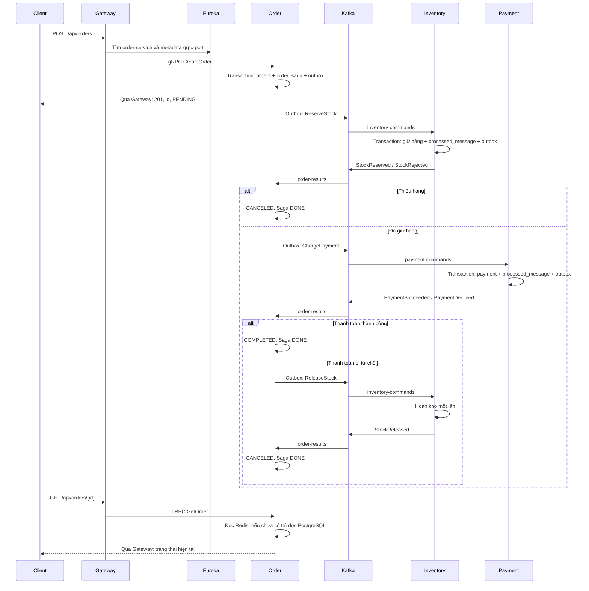

# Luồng đặt hàng Order – Inventory – Payment

Ví dụ dùng Java 21, Spring Boot, PostgreSQL, Kafka, gRPC, Eureka và Redis.
Gateway giữ HTTP cho client; lời gọi đồng bộ từ Gateway vào các service dùng gRPC.
Các bước Saga đi qua Kafka để không phụ thuộc việc các service cùng hoạt động tại một thời điểm.



## Chạy

Cần Docker có Compose. Tại thư mục gốc:

```powershell
docker compose --profile apps up -d --build
docker compose --profile apps ps
```

Đợi các ứng dụng khởi động và đăng ký Eureka. Lúc registry chưa có service, Gateway trả `503`; gọi lại sau vài giây.

| Thành phần | HTTP | gRPC |
| --- | --- | --- |
| Gateway | 8084 | |
| Order | 8081 (Actuator) | 19091 |
| Inventory | 8082 (Actuator) | 19092 |
| Payment | 8083 (Actuator) | 19093 |
| Eureka | 8761 | |
| Kafka UI | 8080 | |

Kafka dùng cổng 9092, PostgreSQL 5432, Redis 6379. HTTP nghiệp vụ cũ tại Order/Inventory/Payment đã được thay bằng gRPC.
`grpc.server.port` được quảng bá dưới metadata `grpc-port` trong Eureka. Gateway lấy host và port này, không hardcode địa chỉ service.

Có thể chạy ứng dụng bằng IntelliJ thay cho Docker: chạy `docker compose up -d postgres redis kafka kafka-ui`, sau đó chạy năm class Application (Eureka trước).
Chạy build tại thư mục gốc với JDK 21: `mvn -DskipTests package`, hoặc dùng `./order-service/mvnw.cmd -f pom.xml -DskipTests package` trên Windows.
Reimport Maven để IDE nhận mã sinh trong `grpc-api/target/generated-sources`.

## Gọi thử qua Gateway

Kho khởi tạo `SKU-001`, `SKU-002`, `SKU-003`, mỗi mã 6 sản phẩm. Dữ liệu đã tồn tại không bị reset khi khởi động lại.

```powershell
$base = 'http://localhost:8084/api'
Invoke-RestMethod "$base/inventory"

$ok = Invoke-RestMethod "$base/orders" -Method Post -ContentType 'application/json' -Body '{"sku":"SKU-001","quantity":2,"paymentDeclined":false}'
$short = Invoke-RestMethod "$base/orders" -Method Post -ContentType 'application/json' -Body '{"sku":"SKU-002","quantity":99,"paymentDeclined":false}'
$declined = Invoke-RestMethod "$base/orders" -Method Post -ContentType 'application/json' -Body '{"sku":"SKU-003","quantity":2,"paymentDeclined":true}'

# Các bước xử lý bất đồng bộ; đọc lại đến khi không còn PENDING.
Invoke-RestMethod "$base/orders/$($ok.id)"
Invoke-RestMethod "$base/orders/$($short.id)"
Invoke-RestMethod "$base/orders/$($declined.id)"
Invoke-RestMethod "$base/inventory"
Invoke-RestMethod "$base/inventory/reservations/$($declined.id)"
Invoke-RestMethod "$base/payments/$($ok.id)"
Invoke-RestMethod "$base/orders/all"
```

| Trường hợp | Order | Reservation | Payment | Tồn kho |
| --- | --- | --- | --- | --- |
| Đủ hàng, thanh toán thành công | COMPLETED | RESERVED | SUCCEEDED | 6 → 4 |
| Không đủ hàng | CANCELED | REJECTED | Không có giao dịch (`404`) | 6 |
| Thanh toán bị từ chối | CANCELED | RELEASED | DECLINED | 6 → 4 → 6 |

`PENDING` bao gồm các bước `RESERVING`, `PAYING`, `RELEASING` trong bảng `order_saga`.
Đơn chỉ chuyển sang `CANCELED` sau khi đã nhận `StockReleased` nếu cần bù trừ.
`paymentDeclined` là cờ giả lập kết quả thanh toán, không gọi cổng thanh toán thật.

## gRPC riêng và kiểm tra xử lý trùng

Hợp đồng nằm ở `grpc-api/src/main/proto/ordering.proto`; adapter nằm trong package `grpc` của từng service.
Có thể import file proto vào Postman gRPC hoặc dùng `grpcurl` (cài riêng). Không cần server reflection:

```powershell
grpcurl -plaintext -import-path grpc-api/src/main/proto -proto ordering.proto localhost:19092 ordering.InventoryApi/ListStock
'{"orderId":"11111111-1111-4111-8111-111111111111","sku":"SKU-002","quantity":2}' | grpcurl -plaintext -import-path grpc-api/src/main/proto -proto ordering.proto -d '@' localhost:19092 ordering.InventoryApi/ReserveStock
'{"id":"11111111-1111-4111-8111-111111111111"}' | grpcurl -plaintext -import-path grpc-api/src/main/proto -proto ordering.proto -d '@' localhost:19092 ordering.InventoryApi/ReleaseStock
```

Lặp lại ReserveStock trước khi ReleaseStock: kho chỉ giảm một lần. Lặp lại ReleaseStock: kho chỉ tăng một lần.
Gửi ReserveStock sau khi đã release cùng orderId không giữ hàng lại.
Gửi Pay nhiều lần với cùng orderId chỉ có một bản ghi payment và giữ kết quả lần đầu.
Các RPC thay đổi Inventory/Payment dùng để kiểm tra riêng trong ví dụ; khi đặt đơn qua Gateway, Saga gửi các lệnh này qua Kafka.

## Các yêu cầu từ mục 8

| Mục | Nơi triển khai |
| --- | --- |
| 8. gRPC | Module `grpc-api`, package `grpc` ở Gateway và ba service; `GrpcServerConfig` khởi động server |
| 9. Transactional Outbox | `schema.sql` ở từng DB; `Outbox.add` yêu cầu transaction đang mở; `OutboxPublisher` gửi rồi mới cập nhật `sent_at` |
| 10. Producer/consumer | Publisher dùng `KafkaTemplate`; ba listener đọc `inventory-commands`, `payment-commands`, `order-results` |
| 11. Saga orchestration | `order-service/.../service/OrderSaga.java`; lưu bước vào PostgreSQL, gửi ReleaseStock khi PaymentDeclined |
| 12. Nghiệp vụ | `InventoryService`, `PaymentService`; tồn kho cập nhật có điều kiện, khóa theo orderId, payment có khóa chính orderId |
| 13. Redis | `OrderCache`: cache đơn đã COMPLETED/CANCELED trong 10 phút; PENDING luôn đọc DB; Redis lỗi thì đọc DB |
| 14. Eureka | `GrpcClients`: discovery từng lần gọi, dùng `grpc-port`, tái sử dụng channel, deadline 5 giây |
| 15. Lỗi/groupId | `GrpcErrors`, `GlobalExceptionHandler`, `KafkaConfig`; tất cả Maven module kế thừa `com.example.orders` |

Kafka consumer group cố ý khác nhau: `order-service`, `inventory-service`, `payment-service`.
Các instance của **cùng** service phải chung group để chia việc; service khác nhau không dùng chung group.
Maven groupId và Kafka group-id là hai khái niệm khác nhau.

## Đảm bảo khi lỗi

- Order, bước Saga và lệnh đầu tiên cùng transaction. Lỗi insert Outbox làm toàn bộ transaction rollback.
- Inventory/Payment ghi nghiệp vụ, `processed_message` và kết quả Outbox cùng transaction. Lỗi rollback cả ba; Kafka chỉ commit offset sau khi xử lý thành công.
- Publisher giao ít nhất một lần: có thể gửi trùng nếu dừng sau Kafka ACK nhưng trước khi ghi `sent_at`. Consumer dùng `processed_message.id` để bỏ qua đúng message đã xử lý; nghiệp vụ còn chống trùng theo orderId.
- Khi Kafka tắt, message ở lại Outbox với `sent_at IS NULL`; publisher thử lại khi Kafka trở lại. Có thể kiểm tra bằng `docker compose stop kafka`, tạo đơn, xem DB, rồi `docker compose start kafka`.
- JSON/lệnh Kafka không hợp lệ chuyển sang topic `<topic>.DLT`; lỗi xử lý tạm thời được retry. Xem DLT trong Kafka UI và sửa/phát lại message nếu cần.
- gRPC trả INVALID_ARGUMENT/NOT_FOUND/ALREADY_EXISTS/INTERNAL; Gateway chuyển thành HTTP 400/404/409/500. Service mất kết nối trả 503, quá deadline trả 504. JSON lỗi chung có `timestamp`, `status`, `code`, `message`, `path`.

Đây là ví dụ chạy local: gRPC plaintext, thanh toán giả lập; chưa có timeout nghiệp vụ cho Saga hay tự động xử lý DLT.
Nếu một participant ngừng hoạt động, đơn chờ PENDING cho tới khi nó xử lý được message.

## Kiểm tra trực tiếp đã thực hiện

Build Maven thành công cho 8 module. Không tạo thêm file test; gọi trực tiếp HTTP/gRPC và kiểm tra PostgreSQL, Redis, Kafka:

- Ba kịch bản thành công, thiếu hàng và thanh toán bị từ chối đều ra đúng trạng thái; Saga hoàn kho trước khi hủy đơn.
- gRPC giữ 2 sản phẩm: 6 → 4 → 6 khi trả. Lặp lại ReserveStock, ReleaseStock, Pay không làm thay đổi nghiệp vụ thêm lần nữa.
- Phát lại các message Kafka đã xử lý: không tăng số bản ghi Outbox hay thay đổi dữ liệu. Đổi messageId nhưng giữ orderId cũng không trừ/cộng kho hay tạo thanh toán thêm.
- Ép insert Outbox lỗi bằng constraint tạm: đơn, Saga và message cùng rollback. Constraint đã được gỡ sau kiểm tra.
- Tắt Kafka rồi tạo đơn: đơn PENDING, Outbox còn message chưa gửi, không cache PENDING. Bật Kafka lại: đơn tự COMPLETED, giữ hàng và thanh toán đúng một lần.
- Tắt Redis: GetOrder vẫn trả dữ liệu từ PostgreSQL. Redis đã được bật lại.
- Gửi JSON hỏng và lệnh lạ vào cả ba topic: message vào DLT, consumer không bị chặn; đơn hợp lệ tiếp theo vẫn COMPLETED.
- Kiểm tra lỗi HTTP 400/404/500 và gRPC INVALID_ARGUMENT/ALREADY_EXISTS; kiểm tra metadata gRPC trong Eureka và TTL Redis.

Các SKU kiểm thử có tiền tố `FLOW-`; không reset tồn kho có sẵn. Các JVM chạy thử đã được dừng để giải phóng cổng cho IntelliJ hoặc Docker Compose.

Tài liệu tham chiếu: [gRPC Java codegen](https://grpc.io/docs/languages/java/generated-code/), [Spring Kafka error handling](https://docs.spring.io/spring-kafka/reference/kafka/annotation-error-handling.html).
